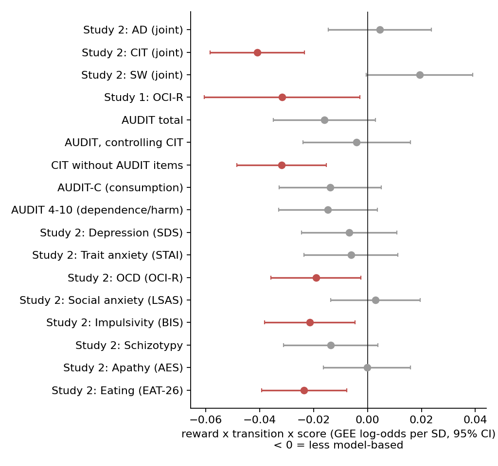
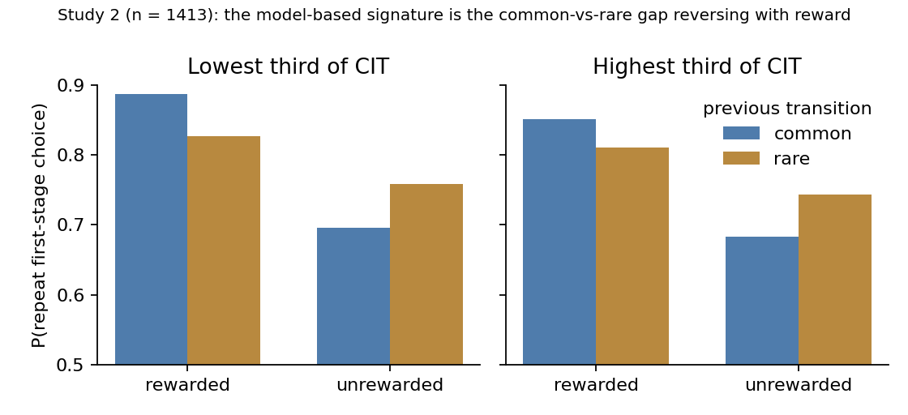
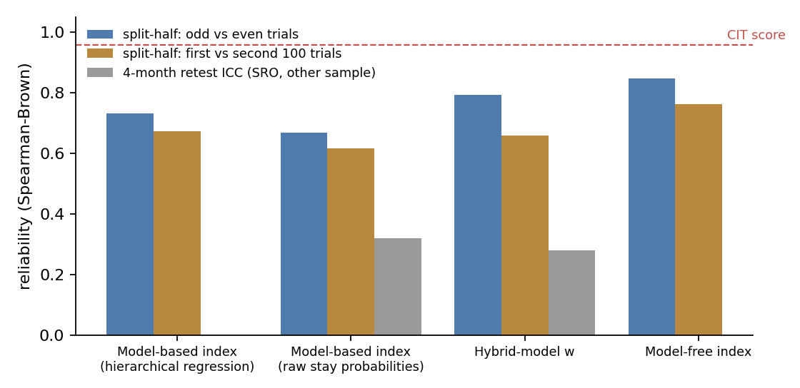
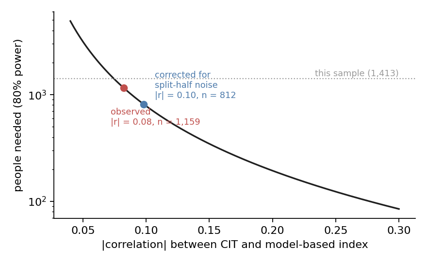

# Compulsivity, alcohol and goal-directed control: an independent replication of Gillan et al. (2016)

Gillan et al. (*eLife* 2016) found that people who plan less ("model-based" control on the two-step task) score
higher on a transdiagnostic **compulsive behaviour and intrusive thought (CIT)** dimension, not on anxious-depression
(AD) or social withdrawal (SW). It is one of the founding results of dimensional computational psychiatry. I
re-analysed their public trial-level data (**Study 1: 548 people, Study 2: 1,413 people**) with my own code and a
[pre-registered plan](docs/REASONING.md) committed before any analysis, and asked three new questions: is the
**alcohol** link separate from compulsivity, how **reliable** is the model-based measure, and does any of this help
**predict an individual**?

## Results in one table

| Pre-registered test | Result | Verdict |
|---|---|---|
| **H1** Study 2: CIT goes with less model-based control (AD, CIT, SW together) | CIT −0.041 [−0.058, −0.023], z = −4.57, p < .001; AD +0.005, p = .64; SW +0.019, p = .055 | **replicated** |
| **H1b** Study 1: OCD symptoms (OCI-R) go with less model-based control | −0.032 [−0.061, −0.003], p = .031 | **replicated** |
| **H2a** Alcohol problems (AUDIT) go with less model-based control | −0.016 [−0.035, +0.003], p = .098 | **not supported** |
| **H2b** The AUDIT effect is largely carried by CIT | shrinks 75% when CIT is added (to −0.004, p = .69), but the bootstrap CI is unusable because the starting effect is ≈ 0 | **not testable** |
| **H2c** CIT rebuilt **without** the AUDIT items still predicts it | −0.032 [−0.048, −0.015], p < .001 (FDR q < .001) | **supported** |
| **H3** Within-session reliability of the model-based index | split-half 0.73 (odd/even), 0.67 (first/second half); CIT score 0.96 | **adequate** (well above the 0.28–0.32 4-month retest seen elsewhere) |
| **H4** Hybrid-model weight *w* is lower with higher CIT | −0.05 SD [−0.11, +0.005], p = .07 (recovery r = 0.81) | **not supported** |
| **H5** Task behaviour predicts a person's CIT score | cross-validated R² gain +0.004 [0.002, 0.005] | **as predicted: negligible** |

*Trial-level effects are reward × transition × score log-odds per SD from a GEE with age, IQ and gender (all interacted
with reward × transition), 277,012 trial pairs. Square brackets are 95% CIs.*



## What I found

**1. The core finding replicates closely with independent code.** With AD, CIT and SW in one model, CIT carries
the deficit (z = −4.57) and AD carries none. Gillan et al.'s glmer gives z = −4.71 for CIT and z = 2.45 for SW. My
GEE coefficients are about 70% of their published ones (CIT −0.041 vs −0.058). That is the expected gap between a
population-averaged GEE and a subject-specific mixed model, and I pre-registered comparing signs and p-values for
this reason. My numbers match almost exactly the re-analysis in the authors' 2019 OSF note (CIT −0.041, SW +0.02,
AD +0.003). The small positive SW effect is in the same direction but just misses p < .05 (p = .055). Dropping
people with many missed trials or one-sided responding changes nothing (n = 1,410, z = −4.59). Study 1 also
replicates (OCI-R p = .031; published p = .049).



**2. Alcohol problems are not a separate, robust signal here.** AUDIT alone gives a small effect that misses
significance (p = .098; the paper reports p = .029 with glmer, so it is borderline either way). Adding CIT removes
75% of it. The other direction holds: CIT rebuilt without the 10 AUDIT items predicts planning just as well
(r = .99 with the full CIT). Exploratory splits give the same picture. Neither consumption (AUDIT-C, p = .15) nor
dependence/harm (items 4–10, p = .12) works on its own, and hazardous drinkers (AUDIT ≥ 8, n = 287) do not differ
(p = .57). In this general-population online sample, a planning deficit linked to alcohol use comes from the
compulsive side of drinking, not from drinking itself. The pre-registered shrinkage test (H2b) could not be
decided: shrinkage is a ratio, and with a denominator near zero its bootstrap CI ran from −330% to +650%.

**3. The measure is reliable enough within a session. The bottleneck is effect size, not noise.** The model-based
index gives split-half reliabilities of 0.73 (odd vs even trials) and 0.67 (first vs second half). The CIT score
gives 0.96. Correcting for that noise only moves the CIT–planning correlation from r = −0.08 to −0.10.
Detecting it at 80% power takes about 1,160 people (about 810 even with perfect measurement). This sample has
1,413, so the effect is real but smaller than most lab studies can see. Combined with my
[self-control-phenotypes](../self-control-phenotypes) result (4-month retest ICC 0.28–0.32 for the same task),
the measure is consistent *within* a session but not *across* months.



**4. The deficit is in model-based *strength*, not in the model-based *share*.** The hybrid model recovers well
(w r = 0.81, every parameter ≥ 0.81), and the hybrid beats pure model-free and pure model-based fits by
integrated BIC (556,620 vs 559,595 vs 571,843). Yet w, the share of control that is model-based, is only weakly
related to CIT (p = .07, H4 not supported). **[post-hoc]** The absolute model-based weight β_MB is strongly related
(−0.12 SD, p < .001), and the model-free weight is not (−0.04, p = .18). w is a ratio, so it mixes the two and
dilutes the effect. Gillan et al.'s own computational model reported separate weights rather than w, which fits
this pattern. For studies that use w as the main phenotype, that choice could hide real effects.

**5. A group effect is not an individual predictor.** Adding every task measure to age, IQ and gender raised
cross-validated R² for CIT by only 0.004 (from 0.070 to 0.074). For AUDIT it did not help at all (−0.003). This
was predicted, and it is the honest limit of the result: it tells us about mechanisms across thousands of people,
not about any one patient.



## Methods

- **Data:** Gillan et al. 2016, OSF [usdgt](https://osf.io/usdgt): per-person two-step CSVs (200 trials), age, IQ,
  gender, questionnaire totals, and Study 2 item-level answers with factor-score weights. I used the authors'
  post-exclusion samples. Factor scores recomputed as z-scored items × weights correlate > 0.9998 with theirs.
- **Model-agnostic analysis:** first-stage stay ~ previous reward × previous transition × (score + age + IQ +
  gender). Trial level: GEE (logit, exchangeable within person, robust SEs). Person level: hierarchical logistic
  regression per person (empirical Bayes), then OLS with HC3.
- **Computational model:** Daw et al. (2011) hybrid (α, β_MB, β_MF, second-stage β, perseveration; λ = 1), fitted by
  hierarchical EM with a Laplace approximation (Huys et al. 2011). Adapted from self-control-phenotypes, with the
  inner loop rewritten (4× faster, identical likelihood) and simulation on each person's actual reward drifts.
- **Reliability:** each half (odd/even trials, or first/second 100 trials) fitted with its own hierarchical prior.
  For the RL model, the learner sees every trial and only the likelihood is split. Spearman–Brown corrected. CIT
  reliability comes from odd vs even items within each questionnaire.
- **Prediction:** ridge regression, 10-fold CV repeated 20 times.

## Limitations

- **Not a glmer replication.** Python has no lme4-style GLMM with random slopes, so the primary test is a GEE. It
  gives smaller coefficients by design. The AUDIT effect lands on different sides of p = .05 under the two methods,
  which says more about its fragility than about either method.
- **Same data, same exclusions.** This is a computational (re-analysis) replication, not a new sample. It checks
  the code and the robustness of choices, not whether the effect appears in new people.
- **Online, general-population sample.** Few people have severe alcohol problems (287 above the hazardous cutoff,
  no diagnoses). The alcohol conclusion may not hold in clinical addiction samples, where Voon et al. (2015) and others
  found model-based deficits directly.
- **Split-half is not retest.** Within-session reliability is an upper bound on stability. The retest figures come
  from a different sample (Self-Regulation Ontology) and a slightly different version of the task.
- **CIT includes the AUDIT items by construction.** H2c handles one direction of the circularity. The factor
  structure itself was estimated in this sample, so H2b cannot fully separate "compulsivity" from "problem drinking".
- The β_MB result is post-hoc; w was the pre-registered computational phenotype.

## Reproduce

```bash
python -m venv .venv && .venv/Scripts/activate
pip install -r requirements.txt
# download https://files.osf.io/v1/resources/usdgt/providers/osfstorage/?zip=  (19 MB) and unzip to data/raw/usdgt/
python scripts/fit_models.py stay_s1 stay_s2 stay_s2_odd stay_s2_even stay_s2_first stay_s2_second \
    hybrid_s1 hybrid_s2 hybrid_s2_odd hybrid_s2_even hybrid_s2_first hybrid_s2_second \
    model_free_s2 model_based_s2 recovery_stay_s2 recovery_hybrid_s1 recovery_hybrid_s2   # ~4 h serial; jobs can run in parallel
python scripts/analyze.py       # GEEs, person-level models, reliability, prediction -> outputs/results.json (~25 min)
python scripts/report.py        # figures
pytest -q                       # 7 tests on synthetic data
```

```
src/cgd/data.py     task-file parser, factor scores, stay design, raw model-based index
src/cgd/models.py   hybrid RL model (masked likelihood + simulation), hierarchical stay regression
src/cgd/fit.py      hierarchical EM fitting, iBIC, recovery (from self-control-phenotypes)
src/cgd/stats.py    GEE, OLS, split-half, attenuation, power, FDR, cross-validated prediction
docs/REASONING.md   pre-registration (committed before any analysis)
```

The OSF project states no licence, so the data are not redistributed here.

---

## 日本語概要

Gillan ら（*eLife* 2016）は、2段階課題で「モデルベース（計画的）制御」が弱い人ほど、診断横断的な「強迫的行動・侵入思考（CIT）」
次元の得点が高く、不安・抑うつ次元とは関係しないことを示しました。本研究では、その公開データ（研究1：548名、研究2：1,413名）を
独自のコードで再解析し、事前登録した計画に沿って、（1）再現性、（2）飲酒問題（AUDIT）との関係、（3）測定の信頼性、を検証しました。

- **再現できました。** CIT は計画性の低さと関連し（z = −4.57）、不安・抑うつは関連しませんでした。研究1の強迫症状でも同じ結果でした。
- **飲酒問題は独立した信号ではありませんでした。** AUDIT 単独の効果は有意でなく（p = .098）、CIT を加えると 75% 縮小しました。
  一方、AUDIT 項目を除いた CIT でも効果は残りました。
- **信頼性は課題内では十分（折半法 0.67〜0.73）でした。** 問題は測定誤差ではなく効果量の小ささ（r ≈ −0.08〜−0.10）で、
  検出には約1,160名が必要です。
- **[事後分析]** モデルベース重みの「割合」w は CIT と有意に関連せず、「強さ」β_MB は強く関連しました。
- 課題データを加えても、個人の CIT 得点の予測精度はほぼ向上しませんでした（R² +0.004）。集団レベルの効果は個人の予測にはなりません。
