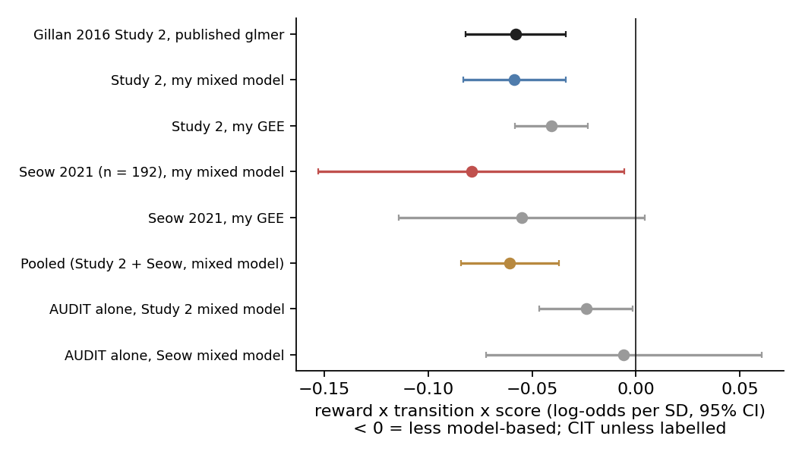

# Compulsivity, not drinking, tracks weaker goal-directed control: an independent-code replication of Gillan et al. (2016) with a mixed-model check, an independent sample, and a reliability analysis

Praruj Thapa · draft, 2026-10-29 · code: this repository · pre-registration: [docs/REASONING.md](REASONING.md)

## Abstract

**Background.** Gillan et al. (2016) reported that weaker goal-directed (model-based) control on the two-step task
is specific to a transdiagnostic compulsivity dimension (CIT). Whether this holds with independent code, under a
different analysis model, and in a new sample is untested. So are whether the alcohol association is separate
from compulsivity and whether the measure is reliable enough for individual-level use.

**Methods.** I re-analysed the public data (Study 1, n = 548; Study 2, n = 1,413) with separately written code
and a pre-registered plan. A pre-registered addendum added a glmer-equivalent logistic mixed model and an
independent lab sample (Seow et al., 2021; n = 192). I tested alcohol problems (AUDIT) with and without CIT,
estimated split-half reliability, and asked whether task behaviour predicts symptom scores out of sample.

**Results.** The mixed model reproduced the published Study 2 estimate almost exactly (CIT −0.0585, z = −4.65;
published −0.058, z = −4.71), and the effect replicated in the independent sample (−0.079, one-sided p = .018;
pooled z = −5.07, no heterogeneity). The AUDIT association depended on the model (mixed model p = .036, GEE
p = .098) and was null in the independent sample (p = .86). Adding CIT removed most of it, and CIT without the
AUDIT items predicted planning in both samples. Split-half reliability was 0.67–0.74 in both samples, but the
effect is small (r ≈ −0.08 to −0.14): about 1,160 people are needed for 80% power. Task behaviour added 0.004 to
the cross-validated R² for CIT. A post-hoc Study 2 finding, that the absolute model-based weight tracks CIT more
strongly than the hybrid weight *w*, did not replicate in the smaller sample.

**Conclusions.** The compulsivity–planning association is robust to code, model and sample. In general-population
samples, it is compulsivity, not drinking as such, that tracks weaker planning. The measure is reliable enough
within a session, but the effect is too small for individual prediction or for typical lab sample sizes.

## 1. Introduction

Goal-directed ("model-based") control lets people choose actions by thinking through what they will lead to,
rather than repeating what was rewarded before ("model-free" control). The two-step task (Daw et al., 2011)
separates the two: after a rare transition, a model-free learner repeats a rewarded first-stage choice, whereas a
model-based learner switches, because it knows the reward came from the other route. Weaker model-based control
has been reported in obsessive-compulsive disorder, binge eating and addiction (Voon et al., 2015), suggesting a
shared mechanism across diagnoses.

Gillan et al. (2016) tested this dimensionally in two large online samples. In Study 2 (n = 1,413), a factor
analysis of 209 questionnaire items gave three transdiagnostic dimensions: anxious-depression (AD), compulsive
behaviour and intrusive thought (CIT), and social withdrawal (SW). Lower model-based control was specific to CIT.
The result has become a reference point for computational psychiatry, and later work in the same group linked it
to how people represent the task's transition structure (Seow et al., 2021).

Three questions remain open, and each matters for the use of this measure in clinical research:

1. **Is the result robust to independent code and to the analysis model?** A replication with separately written
   code tests the analysis pipeline rather than the data. Because the original analysis was a logistic mixed
   model, the choice between mixed-model and population-averaged estimates also needs checking.
2. **Is the alcohol link separate from compulsivity?** Gillan et al. reported a model-based deficit for alcohol
   problems (AUDIT) alone. But the AUDIT items load on CIT by construction, so the alcohol effect may be the
   compulsivity effect seen through a narrower window. This matters for addiction research, where reduced
   model-based control is often read as a marker of drinking itself.
3. **Is the measure reliable enough to study individuals?** Task measures with large group effects often have poor
   test-retest reliability (Hedge et al., 2018; Enkavi et al., 2019). In a separate project, I found 4-month
   retest ICCs of 0.28 to 0.32 for the two-step model-based index in the Self-Regulation Ontology sample.
   Within-session reliability, its effect on observed correlations, and the sample size needed are rarely
   reported together.

I re-analysed the public Study 1 and Study 2 data with my own code and a pre-registered plan committed before
any analysis. After the first results I committed an addendum, again before fitting, that added (a) a
glmer-equivalent mixed model and (b) an independent sample: Seow et al.'s (2021) lab sample of 192 people, who
did the same task and questionnaires.

## 2. Methods

### 2.1 Data

- **Gillan et al. (2016)**, OSF [usdgt](https://osf.io/usdgt). Study 1: 548 people with OCI-R, SDS and STAI.
  Study 2: 1,413 people with nine questionnaires (209 items), the authors' factor-score weights, age, IQ and
  gender. Both did 200 two-step trials online. I used the authors' post-exclusion samples. The OSF project states no
  licence, so the data are not redistributed.
- **Seow et al. (2021)**, OSF [mx9kf](https://osf.io/mx9kf), CC-BY 4.0. 192 people after the authors'
  exclusions, tested in the lab with EEG (not used here). 150 trials, 70/30 transitions, drifting rewards, the same
  nine questionnaires and the I-CAR IQ test. First-stage responses under 150 ms count as missed, as in the
  authors' script.

### 2.2 Symptom dimensions

AD, CIT and SW were computed as items z-scored within each sample, multiplied by Gillan et al.'s factor-score
weights. In Study 2 these correlate above 0.9998 with the authors' scores. For the alcohol question I also built
CIT without the 10 AUDIT items, and AUDIT subscales for consumption (items 1–3) and dependence/harm (items 4–10).

### 2.3 Model-agnostic analysis

The dependent variable is whether the first-stage choice is repeated ("stay"). It is predicted from the previous
trial's reward (±1) and transition (common/rare, ±1). The reward × transition interaction is the model-based
signature. Each symptom score interacts with reward × transition, with age, IQ and gender as covariates.

- **Mixed model (primary for the addendum):** `stay ~ reward * transition * (scores + age + IQ + gender) +
  (reward * transition | subject)`, logit link, Laplace approximation (glmer's default), full 4 × 4 random-effect
  covariance, Wald z. Python has no lme4. Because the design has two binary predictors, each person's trials reduce
  to four binomial cells, so I wrote the marginal likelihood directly (`cgd.stats.glmm`) and checked it on
  synthetic data.
- **GEE (primary in the original pre-registration):** the same fixed effects, exchangeable working correlation,
  robust SEs. GEE estimates population-averaged effects, which are smaller than a mixed model's subject-specific
  effects by construction.

### 2.4 Computational model

The Daw et al. (2011) hybrid model: learning rate α, model-based and model-free weights β_MB and β_MF,
second-stage β, perseveration, with eligibility λ = 1. w = β_MB / (β_MB + β_MF). It was fitted by hierarchical
expectation-maximisation with a Laplace approximation (Huys et al., 2011), and parameter recovery was checked by
simulating each person's fitted parameters on their own reward schedule. Pure model-free and pure model-based
variants were compared by integrated BIC.

### 2.5 Reliability, attenuation and power

Split-half reliability (odd vs even trials; first vs second 100 trials in the Gillan samples), Spearman–Brown
corrected. For the hierarchical measures each half was fitted with its own prior, and for the RL model the
learner saw every trial while only the likelihood was split. CIT reliability came from odd vs even items within
each questionnaire. Observed correlations were disattenuated with both reliabilities, and the sample size for 80%
power was computed with the Fisher z approximation.

### 2.6 Prediction

Ridge regression, 10-fold cross-validation repeated 20 times. Task features (model-based and model-free indices,
perseveration, w, median RTs) plus covariates were compared with covariates alone.

### 2.7 Pre-registration and deviations

The original plan (H1–H5) was committed before any analysis, and the addendum (A1–A2, B1–B4) before any mixed
model was fitted to real data and before the independent sample was downloaded. Deviations: (1) the first/second
half split exists only for the 200-trial Gillan data; (2) the β_MB analysis is post-hoc and is labelled as such;
(3) the first-stage 150 ms exclusion for the Seow data follows the authors' script and was not written into the
addendum.

## 3. Results

*Figure 1. Reward × transition × score coefficients (log-odds per SD, 95% CI). CIT unless labelled.*

### 3.1 The compulsivity effect replicates with independent code, a mixed model, and a new sample

In Study 2, with AD, CIT and SW in one model, the mixed model gave CIT −0.0585 (z = −4.65, p < .001), SW +0.032
(z = 2.43, p = .015) and AD +0.004 (p = .76). Gillan et al.'s Table 3 reports −0.058 (z = −4.71) and +0.031
(z = 2.45). The difference for CIT, 0.0005, is well inside the pre-registered ±0.010 margin (A1). The GEE
estimate was smaller as expected (−0.041, z = −4.57) and matches the authors' own 2019 population-averaged note.
The result held when people with many missed trials or one-sided responding were excluded (GEE, n = 1,410,
z = −4.59).

In Study 1 (OCI-R only), the result is borderline under every method: mixed model −0.040, p = .053; GEE p = .031;
published p = .049.

In the independent Seow et al. sample, CIT again predicted less model-based control (mixed model with AD and
SW: −0.079 [−0.153, −0.006], z = −2.11, one-sided p = .018). The pre-registered verdict (B1) is
**replicated**. The estimate did not differ from Study 2 (difference p = .60). Pooling the two gives −0.061
[−0.084, −0.037], z = −5.07, with no heterogeneity (Q = 0.27, p = .60) (B2). The GEE version was weaker
(−0.055, two-sided p = .069; CIT alone p = .040). The authors' own specification, without covariates, gave −0.077
(p = .041). Before looking, I had put the power of this test at about 45%. The estimate was larger than
expected, probably partly by chance and partly because the lab sample measured the effect more cleanly
(r(CIT, raw model-based index) = −0.14, against −0.08 online).

### 3.2 Alcohol problems: fragile on their own, carried by compulsivity

| | Study 2 GEE | Study 2 mixed model | Seow mixed model |
|---|---|---|---|
| AUDIT alone | −0.016, p = .098 | −0.024, p = .036 | −0.006, p = .86 |
| AUDIT controlling CIT | −0.004, p = .69 | −0.008, p = .53 | +0.001, p = .98 |
| CIT without AUDIT items | −0.032, p < .001 | −0.045, p < .001 | −0.069, p = .037 |

The two methods disagree on AUDIT alone in Study 2, so by the pre-registered rule (A2) the alcohol effect is
**fragile (model-dependent)**. In the independent sample it is absent. In both samples, adding CIT removes most of
it (68% in the Study 2 mixed model), while CIT rebuilt without the 10 AUDIT items keeps its effect.
Consumption (AUDIT-C) and dependence/harm (items 4–10) behave similarly in Study 2 (mixed model p = .095 and
p = .040). Hazardous drinkers (AUDIT ≥ 8, n = 287) do not differ from others (GEE p = .57). In these
general-population samples, the planning deficit that comes with drinking problems is the compulsivity deficit.
The pre-registered shrinkage CI (H2b) was uninformative because the denominator was near zero.

Among the other questionnaires (Study 2 mixed model), impulsivity (BIS, p = .003), eating (EAT-26, p = .003) and
OCD symptoms (OCI-R, p = .022) were associated with less model-based control. Depression, trait anxiety, social
anxiety, apathy and schizotypy were not.

### 3.3 Reliability is adequate within a session; the effect size is the bottleneck

| Split-half (Spearman–Brown) | Study 2, odd/even | Study 2, first/second | Seow, odd/even |
|---|---|---|---|
| Model-based index (hierarchical) | 0.73 | 0.67 | 0.74 |
| Model-based index (raw) | 0.67 | 0.62 | 0.67 |
| Hybrid *w* | 0.79 | 0.66 | – |
| CIT (odd/even items) | 0.96 | – | 0.94 |

Reliability replicated across samples and settings. Correcting the Study 2 CIT–model-based correlation for
measurement noise moves it only from −0.082 to −0.098 (−0.102 with the first/second split). 80% power needs
about 1,160 people at the observed size and about 810 even with perfect measurement. The 4-month retest
reliability of the same index in another sample is 0.28–0.32 (Self-Regulation Ontology), so the measure is
consistent within a session but drifts across months.

### 3.4 Computational model

The hybrid model fitted better than pure model-free or pure model-based variants (Study 2 iBIC 556,620 vs
559,595 vs 571,843), and all parameters were recovered well (Study 2: r ≥ 0.81, w 0.81; Seow: r ≥ 0.73,
w 0.74). The hybrid weight w was not reliably related to CIT in Study 2 (−0.052 SD [−0.108, 0.005], p = .07; H4
not supported) or in the Seow sample (−0.012, p = .90).

**[Post-hoc]** In Study 2, the absolute model-based weight (log β_MB) was strongly related to CIT (−0.117 SD
[−0.169, −0.064], p < .001) and the model-free weight was not (−0.039, p = .18). This suggested that the ratio w
dilutes the effect. The pattern did **not** replicate in the Seow sample (log β_MB −0.047 [−0.242, 0.147],
p = .63), although that CI includes the Study 2 value and the test had only about 35% power. I treat it as an
open hypothesis, not a finding.

### 3.5 A group effect is not an individual predictor

Adding all task features to age, IQ and gender raised cross-validated R² for CIT from 0.070 to 0.074 (gain 0.004
[0.002, 0.005]) and did not help for AUDIT (−0.003). This was pre-registered (H5, expected gain below 0.02).

## 4. Discussion

Gillan et al.'s central result survives every check I could apply: separately written code, the same mixed
model, a population-averaged model, exclusion of low-quality participants, and a new sample collected in a
different setting. The pooled estimate (−0.061 log-odds per SD of CIT) is almost identical to the original.
Specificity also held: anxious-depression showed nothing in either sample.

The alcohol result is the clearest case where the analysis choice matters. AUDIT alone crosses p = .05 depending
on whether the model is subject-specific or population-averaged, and it disappears in a second sample. In
contrast, the compulsivity signal survives removal of the alcohol items. This fits a view in which reduced
model-based control is a marker of compulsive habit formation that cuts across diagnoses. On that view, drinking
problems show the deficit only to the extent that they are compulsive. It does not rule out larger deficits in
clinical alcohol dependence (Sebold et al., 2014; Voon et al., 2015), where compulsivity is higher and the range
of drinking is much wider than in these samples.

The reliability results change what the effect means for practice. With split-half reliability around 0.7 in
both samples, noise is not what hides the effect. The effect is simply small: about 1–2% of variance. Two
consequences follow. Studies of a few dozen patients cannot detect it reliably, and the task cannot be used to
assess individuals: adding task behaviour barely improved the prediction of a person's CIT score. Its value is
as a mechanistic probe in large samples, and as a target for better tasks. Reaction-time and drift-diffusion
extensions, for example, can improve reliability (Shahar et al., 2019).

The β_MB result illustrates why the independent sample was worth adding. In Study 2 it looked like a strong,
interpretable finding: the "share" parameter w hides an effect in the "strength" parameter. With n = 192 it did
not replicate. The test was underpowered, so this is not evidence against it, but it is a reason not to build on
it until it holds in a larger sample.

## 5. Limitations

- **The mixed model is my own implementation, not lme4.** It fits the same model with the same approximation and
  reproduces the published estimates to three decimals, which is strong evidence that it is correct, but it is not
  the reference software.
- **Study 1 and Study 2 are re-analyses.** They check the code and analysis choices, not new people. The Seow
  sample is new people but small, and its authors had already reported a compulsivity effect, so the direction
  was not blind.
- **General-population samples.** Few participants drink at clinical levels. The alcohol conclusion may not
  transfer to treatment-seeking samples.
- **Split-half is not test-retest.** Within-session reliability is an upper bound on stability, and the retest
  figure comes from a different sample and task version.
- **The factor weights come from Study 2.** Applying them to Study 2 itself makes CIT optimally weighted for that
  sample. The Seow sample uses the same weights out of sample, which is a fairer test.

## 6. Data and code availability

Code, pre-registration, results (`outputs/results.json`, `outputs/results_addendum.json`) and figures are in
this repository. Raw data: OSF usdgt (no licence stated; not redistributed) and OSF mx9kf (CC-BY 4.0;
Seow, Benoit, Dempsey, Jennings, Maxwell, O'Connell & Gillan, 2021).

## References

- Daw, N. D., Gershman, S. J., Seymour, B., Dayan, P., & Dolan, R. J. (2011). Model-based influences on humans'
  choices and striatal prediction errors. *Neuron*, 69(6), 1204–1215.
- Enkavi, A. Z., Eisenberg, I. W., Bissett, P. G., Mazza, G. L., MacKinnon, D. P., Marsch, L. A., & Poldrack, R. A.
  (2019). Large-scale analysis of test–retest reliabilities of self-regulation measures. *PNAS*, 116(12),
  5472–5477.
- Gillan, C. M., Kosinski, M., Whelan, R., Phelps, E. A., & Daw, N. D. (2016). Characterizing a psychiatric
  symptom dimension related to deficits in goal-directed control. *eLife*, 5, e11305.
- Hedge, C., Powell, G., & Sumner, P. (2018). The reliability paradox: Why robust cognitive tasks do not produce
  reliable individual differences. *Behavior Research Methods*, 50(3), 1166–1186.
- Huys, Q. J. M., Cools, R., Gölzer, M., Friedel, E., Heinz, A., Dolan, R. J., & Dayan, P. (2011). Disentangling
  the roles of approach, activation and valence in instrumental and Pavlovian responding. *PLoS Computational
  Biology*, 7(4), e1002028.
- Sebold, M., Deserno, L., Nebe, S., Schad, D. J., Garbusow, M., Hägele, C., ... & Huys, Q. J. M. (2014).
  Model-based and model-free decisions in alcohol dependence. *Neuropsychobiology*, 70(2), 122–131.
- Seow, T. X. F., Benoit, E., Dempsey, C., Jennings, M., Maxwell, A., O'Connell, R., & Gillan, C. M. (2021).
  Model-based planning deficits in compulsivity are linked to faulty neural representations of task structure.
  *Journal of Neuroscience*, 41(30), 6539–6550.
- Shahar, N., Hauser, T. U., Moutoussis, M., Moran, R., Keramati, M., NSPN consortium, & Dolan, R. J. (2019).
  Improving the reliability of model-based decision-making estimates in the two-stage decision task with
  reaction-times and drift-diffusion modeling. *PLoS Computational Biology*, 15(2), e1006803.
- Voon, V., Derbyshire, K., Rück, C., Irvine, M. A., Worbe, Y., Enander, J., ... & Bullmore, E. T. (2015).
  Disorders of compulsivity: a common bias towards learning habits. *Molecular Psychiatry*, 20(3), 345–352.

*References were written from memory; check volume and page numbers before submission.*
